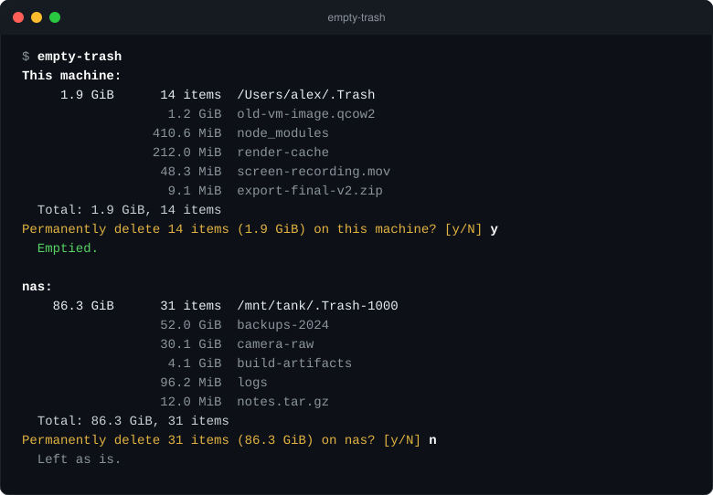

<h1 align="center">empty-trash</h1>

<p align="center">
  <b>See what is in the trash. Then decide.</b><br>
  One command for your Mac, your Linux machine and every host you reach with SSH.
</p>

<p align="center">
  <a href="https://github.com/EspenJD/empty-trash/actions/workflows/ci.yml"></a>
  <a href="LICENSE"></a>
  
  
</p>

<p align="center">
  
</p>

## Why

Deleting with `trash` instead of `rm` is a good rule. It is an even better rule for scripts and AI
coding agents, because a wrong delete stays reversible. The cost: the trash fills up, on every
machine that you work on, and nobody empties it.

`empty-trash` is the other half of that rule:

- **You see first.** Each trash folder with its size, its item count and its five biggest items.
- **You decide.** It deletes only after you type `y` at a terminal.
- **An agent cannot empty with it.** Without a terminal the command only lists. There is no
  `--yes` option and no environment variable that skips the question.
- **All your machines.** The same list and the same question for each SSH host. Nothing to install
  there.

It is one bash file with no dependencies.

## Install

```bash
mkdir -p ~/.local/bin
curl -fsSL https://raw.githubusercontent.com/EspenJD/empty-trash/main/empty-trash -o ~/.local/bin/empty-trash
chmod +x ~/.local/bin/empty-trash
```

Make sure that `~/.local/bin` is on your `PATH`. Or clone the repository and link the file:

```bash
git clone https://github.com/EspenJD/empty-trash.git
ln -s "$PWD/empty-trash/empty-trash" ~/.local/bin/empty-trash
```

Needs bash 3.2 or newer and the standard tools `find`, `du` and `awk`. The bash that comes with
macOS works.

## Use

```bash
empty-trash                 # this machine, then each host in your hosts file
empty-trash --list          # list only, never delete
empty-trash local           # this machine only
empty-trash nas buildbox    # these SSH hosts only
empty-trash --sudo          # also root's trash and items that only root can delete
```

| Option | What it does |
|---|---|
| `-l`, `--list` | List only. Never deletes. |
| `--sudo` | Works through `sudo`: root's trash, and items in your trash that only root can delete. |
| `-h`, `--help` | Shows the help. |
| `-V`, `--version` | Shows the version. |

Exit code: `0` is all good. `1` means that something needs your attention: a host did not answer,
a folder could not be read, or an item could not be deleted. `2` is a usage error.

## What it empties

| System | Folder | What it is |
|---|---|---|
| macOS | `~/.Trash` | Your trash |
| macOS | `~/Library/Mobile Documents/.Trash` | The iCloud Drive trash, when it exists |
| macOS | `/Volumes/<disk>/.Trashes/<uid>` | Your trash on each mounted disk |
| Linux | `~/.local/share/Trash` | Your home trash (`$XDG_DATA_HOME/Trash`) |
| Linux | `<mount>/.Trash-<uid>` and `<mount>/.Trash/<uid>` | Your trash on each mounted filesystem |

With `--sudo` it also takes root's folders of the same kinds.

On Linux the command follows the
[FreeDesktop.org Trash specification](https://specifications.freedesktop.org/trash/latest/):
it deletes the contents of `files/` and `info/` and the `directorysizes` cache. It also clears
`expunged/`, the folder where GNOME keeps items that it could not delete. The trash folders
themselves always stay.

## Other machines

Give host names on the command line, or list them once:

```
# ~/.config/empty-trash/hosts
nas
buildbox sudo
alex@media-server
```

Each line is a host that `ssh` knows. Add the word `sudo` to use sudo on that host.

The word also applies when you name the host on the command line: with the file above,
`empty-trash buildbox` uses sudo and `empty-trash nas` does not. The name must be the same as in
the file. `--sudo` uses sudo on every target, whatever the file says. A host that is not in the
file gets sudo only with `--sudo`.

The host needs bash and your SSH key, nothing else. The command sends itself through
`ssh HOST bash -s`, the host lists its trash, and the question comes to **your** terminal. A host
that is off gets one line and exit code 1; the other hosts still run.

For `sudo` on a host, sudo must work there without a password.

## What it will not do

- **Delete without a question.** The answer must be `y` or `Y`. Enter alone means no.
- **Delete without a terminal.** A pipe, a script, a cron job or an agent run gets the list and the
  line `no terminal on stdin, so this run only lists`.
- **Touch a folder that is not a trash folder.** Only folders with a trash name, that are real
  folders (not symbolic links), and that you or root own.
- **Follow a symbolic link.** A link in the trash is deleted as a link. Its target stays.
- **Leave the filesystem.** If another filesystem is mounted below an item, it is not entered
  (when your `rm` has `--one-file-system` or `-x`).
- **Hide a failure.** An item that stays is counted and reported, with exit code 1.

Two honest limits:

- This is a guard rail, not a sandbox. A program with a shell can still run `rm`. The point is
  that the obvious command, the one in your notes and in your agent's rules, never deletes on its
  own.
- An item that arrives in the trash between the list and your answer is deleted too.

## Rules for an AI agent

Put this in `AGENTS.md`, `CLAUDE.md` or the rules file of your agent:

```markdown
Delete with `trash`, never with `rm`. After you trash files, show me the command `empty-trash`.
Never empty the trash yourself.
```

Recent macOS versions include a `trash` command. On Linux use `gio trash` (GLib) or `trash-put`
from [trash-cli](https://github.com/andreafrancia/trash-cli).

## Questions

**macOS says "no access" for `~/.Trash`.**
macOS protects the trash. Give your terminal app Full Disk Access: System Settings > Privacy &
Security > Full Disk Access. For a Mac that you reach through SSH: System Settings > General >
Sharing > Remote Login > "Allow full disk access for remote users". Until then the command says
"no access" and deletes nothing there.

**Why is there no `--yes`?**
Because then every script and every agent could empty the trash, and the trash would stop being a
safety net. For a timed cleanup without a question, use `trash-empty` from trash-cli.

**An item is "still there".**
It is locked, in use, or only root can delete it. On Linux, `--sudo` deletes items that only root
can delete. On macOS, Finder can empty locked items.

**Does it overwrite the data?**
No. It deletes files in the normal way.

**Windows?**
No. Inside WSL it works as on Linux.

## Tests

```bash
tests/run.sh
```

44 checks on fake trash folders in a temporary folder, for both folder layouts, with stand-ins
for `ssh` and `sudo`. No test deletes in a real trash. CI runs them on Linux and on macOS, and
[ShellCheck](https://www.shellcheck.net/) checks the code.

## Similar tools

- [trash-cli](https://github.com/andreafrancia/trash-cli): `trash-put`, `trash-list`,
  `trash-empty` and more for Linux. `trash-empty` can delete by age and without a question.
- [sindresorhus/empty-trash](https://github.com/sindresorhus/empty-trash): a Node.js library with
  the same name. It is a different project.

## Credits

- The [FreeDesktop.org Trash specification](https://specifications.freedesktop.org/trash/latest/),
  for the folder layout on Linux.
- [trash-cli](https://github.com/andreafrancia/trash-cli) by Andrea Francia and its contributors,
  the reference tool for the Linux trash.
- [ShellCheck](https://github.com/koalaman/shellcheck) by Vidar Holen and its contributors.
- Written with [Claude Code](https://claude.com/claude-code).

## License

[MIT](LICENSE)
